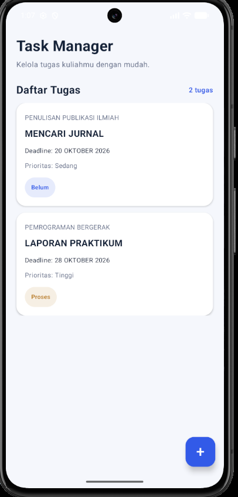
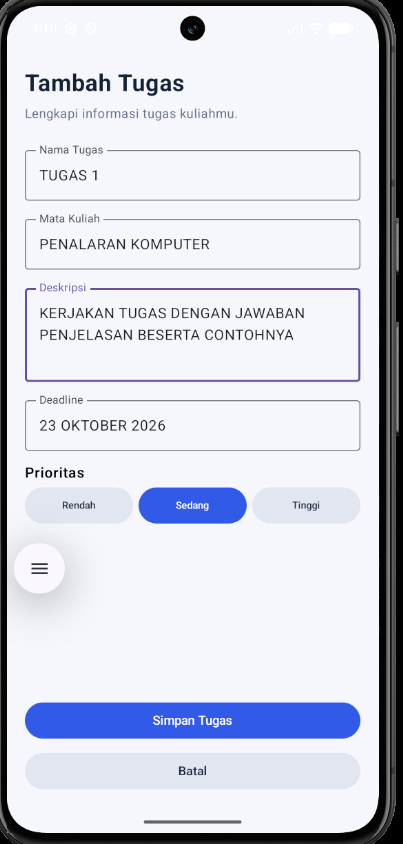
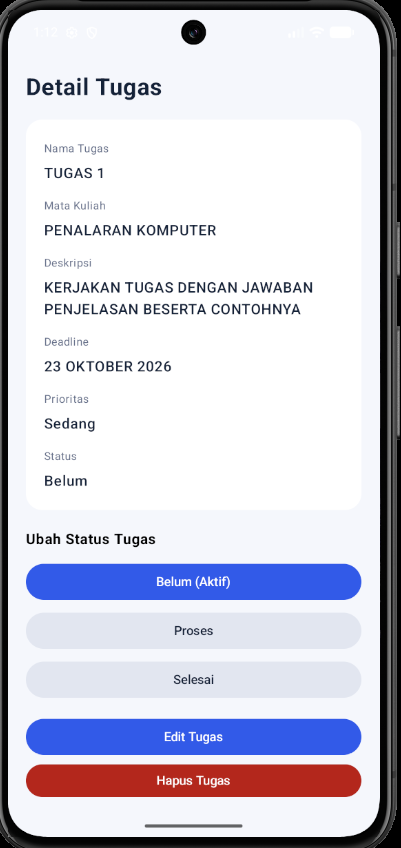
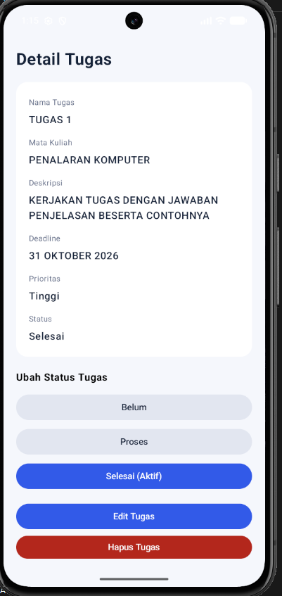
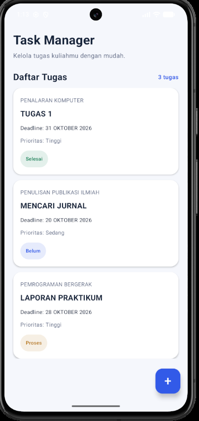

# OfflineTaskManager

## Deskripsi
OfflineTaskManager adalah aplikasi Android untuk mengelola tugas secara offline. Aplikasi dikembangkan menggunakan Kotlin, Jetpack Compose, dan Room Database untuk penyimpanan data lokal.

## Fitur
- Menampilkan daftar tugas.
- Menambahkan tugas.
- Melihat detail tugas.
- Mengedit tugas.
- Mengubah status tugas.
- Menghapus tugas.
- Menyimpan data secara lokal menggunakan Room Database.

## Pengujian Aplikasi

Pengujian dilakukan untuk memeriksa fungsi utama aplikasi OfflineTaskManager.

| No. | Skenario Pengujian | Hasil yang Diharapkan |
|---|---|---|
| 1 | Menambahkan tugas | Tugas baru tersimpan dan tampil pada daftar. |
| 2 | Melihat detail tugas | Detail tugas ditampilkan dengan benar. |
| 3 | Mengedit tugas | Perubahan informasi tugas tersimpan. |
| 4 | Mengubah status tugas | Status tugas diperbarui sesuai pilihan. |
| 5 | Menghapus tugas | Tugas terhapus dari daftar. |
| 6 | Membuka kembali aplikasi | Data yang tersimpan tetap tersedia. |

Catatan: Pastikan setiap skenario telah diuji sebelum menyatakan hasilnya berhasil.

## Screenshot Aplikasi

### 1. Halaman Utama

### 2. Tambah Tugas

### 3. Detail Tugas

### 4. Edit Deadline

### 5. Hasil Update

## Teknologi
- Kotlin
- Jetpack Compose
- Room Database
- ViewModel
- Repository Pattern
- Android Studio
- Git dan GitHub

## Struktur Proyek
- `data/`: Entity, DAO, database, dan repository.
- `viewmodel/`: Pengelolaan state dan logika aplikasi.
- `ui/theme/`: Pengaturan tema aplikasi.
- `MainActivity.kt`: Activity utama.

## Cara Menjalankan
1. Clone repository dari GitHub.
2. Buka proyek di Android Studio.
3. Tunggu Gradle Sync selesai.
4. Jalankan aplikasi melalui emulator atau perangkat Android.

## Repository
https://github.com/Mrfli330/OfflineTaskManager

## Pengembang
- Nama: Muhamad Rafli
- NIM: 2411073
- Program Studi: Informatika
- Universitas Mulia
